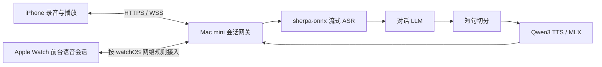

# iPhone / Apple Watch 免费语音助手方案调研

调研日期：2026-11-08。用途：个人中文语音对话，支持公网接口和低延迟播放。

> 范围更新：当前 Steer Watch 聚焦任务通知、短句语音输入、文字结果及用户主动选择的朗读；完整语音助手是后续目标。下文双向会话架构为远期方案。当前选型以本文末尾的 Auday 调研与阶段建议为准。

## 已确认的设备与结论

经用户授权，通过 SSH 对 `kongdefei@192.168.31.248` 只读查询：Mac mini，Apple M4，10 核 CPU，16GB 统一内存，macOS 26.4.1。未安装模型、未启动服务。iPhone / Watch 型号尚未确认。

这台机器适合先验证单用户语音链路。以下推荐属于架构判断，不是这台机器的实测性能结论：

- 首选 ASR：sherpa-onnx + 中英 streaming Paraformer；优先保证实时音频输入。
- 首选服务端 TTS：MLX-Audio + Qwen3-TTS-12Hz-0.6B-CustomVoice-8bit；固定音色开始。
- 识别质量对照：Qwen3-ASR-0.6B-8bit，先用于句末识别；whisper.cpp 作为成熟的离线/端侧备选。
- Apple 原生备选：iPhone 本地 SpeechAnalyzer / SpeechTranscriber + AVSpeechSynthesizer；Mac 也可评估原生 Speech 后端。
- Ming-3.0-tts 列入音色/表现力对照，不作为第一版低延迟默认模型。

“免费”指本地推理没有按次模型 API 费用，仍有电费、网络和维护成本；对话 LLM 的成本单独计算。开源模型可免费下载不代表 Hugging Face 托管推理免费。

## 必须区分的流式能力

1. 网络分块上传：服务器逐步收到录音，但模型可能仍等录完才推理。
2. ASR 实时输入：持续接收新音频，输出可修订的 partial 和确认的 final。
3. ASR 文字流：对已经收到的音频逐 token 输出文字，不代表实时输入。
4. TTS 音频流：输入一段文字，音频边生成边返回。
5. TTS 双向流：文字持续到达，语音也持续生成；模型、推理引擎、API 都要支持。

把完整 WAV 拆成 HTTP 数据块不会减少模型的首音生成时间。第一版可以采用“LLM 流式文字 → 短句切分 → TTS 音频流”，不必等整个答案完成。

## ASR 比较

| 方案 | 免费与许可 | Apple 设备适配 | 流式核查 | 建议 |
|---|---|---|---|---|
| sherpa-onnx + streaming Paraformer 中英模型 | 引擎 Apache-2.0；这里选定的模型卡也标 Apache-2.0 | 支持 macOS / iOS，CPU 路线可用 | 有在线模型、麦克风识别示例和 WebSocket 服务生态 | 公网实时识别首选候选 |
| Qwen3-ASR-0.6B-8bit / MLX | 模型卡 Apache-2.0 | Apple Silicon Mac 的 MLX 转换版本 | 当前核查的 `stream_transcribe` 接收文件或完整数组，再逐步输出转写；不等同持续麦克风输入 | 中文识别质量对照；句末识别候选 |
| whisper.cpp | MIT | Metal / Core ML；有 iPhone 离线示例 | 自带 stream 示例采用周期识别，README 称其为 naive example；需要窗口、去重和稳定提交逻辑 | 成熟备选，不能直接视为原生在线识别器 |
| Apple SpeechAnalyzer / SpeechTranscriber | 系统 API，无单次云推理账单；闭源 | iOS 26 / macOS 26 等；SpeechTranscriber 不支持 watchOS | 有实时、端侧转写 API | iPhone 原生路线值得同时测试 |
| VibeVoice-ASR-Streaming | 项目 MIT；具体部署检查点仍需核对模型卡 | 官方示例侧重 CUDA / NVIDIA | 官方已经有持续音频输入与 WebSocket 示例 | 不是当前 M4 16GB 的第一选择 |

Qwen 官方 ASR 支持离线与流式，但当前 README 指出其官方流式推理走 vLLM 后端。这与 MLX 转换版支持什么接口是两件事。不能把官方 NVIDIA / 高并发吞吐数据当作 Mac mini 延迟数据。

Apple 原生识别必须运行时检查 `SpeechTranscriber.isAvailable`、支持的 locale 和模型资源；不能仅凭系统版本承诺指定设备和中文 locale 可用。旧 `SFSpeechRecognizer` 也不能一概视为离线，需明确检查端侧识别支持。

来源：[sherpa-onnx](https://github.com/k2-fsa/sherpa-onnx)、[在线 Paraformer](https://k2-fsa.github.io/sherpa/onnx/pretrained_models/online-paraformer/paraformer-models.html)、[选定模型许可](https://huggingface.co/csukuangfj/sherpa-onnx-streaming-paraformer-bilingual-zh-en)、[Qwen3-ASR 官方](https://github.com/QwenLM/Qwen3-ASR)、[Qwen MLX 模型](https://huggingface.co/mlx-community/Qwen3-ASR-0.6B-8bit)、[MLX ASR 实现](https://github.com/Neywa-Labs/mlx-audio/blob/main/mlx_audio/stt/models/qwen3_asr/qwen3_asr.py)、[whisper.cpp](https://github.com/ggml-org/whisper.cpp)、[Apple WWDC25](https://developer.apple.com/videos/play/wwdc2025/277/)、[Apple 可用性检查](https://developer.apple.com/documentation/speech/speechtranscriber)、[VibeVoice 流式 ASR](https://github.com/microsoft/VibeVoice/blob/main/docs/vibevoice-asr-streaming.md)。

## TTS 比较

| 方案 | 免费与许可 | 中文与功能 | 当前流式能力与限制 | 建议 |
|---|---|---|---|---|
| Qwen3-TTS-12Hz-0.6B-CustomVoice-8bit / MLX | 模型卡 Apache-2.0 | 中英等多语言；预置音色 | MLX-Audio README 有该模型 `--stream` 示例；持续追加文字能力需另验 | 服务端首选候选 |
| Ming-3.0-tts-0.5B-bf16 / MLX | MIT | 中文、多语、音色控制与克隆 | 当前实现 `stream=True` 按文本 fragment 输出；每个 fragment 先生成全部 latent 再解码，不能视为细粒度实时音频流 | 音质对照 |
| VibeVoice-Realtime-0.5B | 模型卡 MIT | 以英语为主，实验多语言列表未列中文 | 宣称流式文字输入；文档仍有相关 TODO，实际持续追加文本接口需验证 | 英语项目可评估，中文不优先 |
| Kokoro-82M | Apache-2.0 | 有中文及其他语言音色，模型小 | 可按文本片段输出，别等同于 token 级双向流式 | 速度/资源对照 |
| Apple AVSpeechSynthesizer | 系统 API，闭源 | 使用设备可用音色 | 可逐句朗读；支持的平台上可回调取得音频 buffer | 原生客户端低成本默认/兜底 |
| CosyVoice 3 | 仓库 Apache-2.0；选定权重再核对模型卡 | 中文、多语、音色克隆 | 官方宣称文字输入与音频输出双流式 | 二阶段候选，Mac 后端性能未验证 |

Qwen 的 CustomVoice 是预置音色模型；任意参考音频克隆应该选 Base 版本。不要因社区模型卡示例出现 `ref_audio` 就误判 CustomVoice 支持任意克隆。0.6B CustomVoice 与 1.7B 版本的指令控制能力也不完全相同。

Ming 社区卡报告：磁盘约 3GB、峰值内存约 4.4GB、M4 Pro 上 RTF 约 1.0（生成耗时/音频时长）。这是社区结果，不是本机 M4 结果；RTF 1 不代表首音低延迟。模型卡要求 MLX-Audio >= 0.6.1，并列出文本归一化、说话人嵌入和停止行为限制；数字和日期朗读要单独验证。

VibeVoice 的不同分支应分开看：早期长音频 TTS 不等同 Realtime；仓库当前也有 ASR。Realtime 文档提到 M4 Pro 可实时运行，因此不能说其仅支持 NVIDIA，但也不能据此承诺基础 M4 实时。官方材料的约 200–300ms 是特定环境下首音描述，不是公网端到端承诺。

来源：[Qwen TTS 官方型号表](https://github.com/QwenLM/Qwen3-TTS)、[Qwen MLX 模型](https://huggingface.co/mlx-community/Qwen3-TTS-12Hz-0.6B-CustomVoice-8bit)、[MLX-Audio 流式示例](https://github.com/Neywa-Labs/mlx-audio)、[Ming 上游](https://github.com/inclusionAI/Ming-3.0-tts)、[Ming MLX 模型卡](https://huggingface.co/mlx-community/Ming-3.0-tts-0.5B-bf16)、[Ming MLX 源码](https://github.com/Neywa-Labs/mlx-audio/blob/main/mlx_audio/tts/models/bailingmm/bailingmm.py)、[VibeVoice Realtime](https://github.com/microsoft/VibeVoice/blob/main/docs/vibevoice-realtime-0.5b.md)、[VibeVoice 模型许可](https://huggingface.co/microsoft/VibeVoice-Realtime-0.5B)、[Kokoro](https://huggingface.co/hexgrad/Kokoro-82M)、[Apple 音频 buffer](https://developer.apple.com/documentation/avfaudio/avspeechsynthesizer/write(_:tobuffercallback:))、[CosyVoice](https://github.com/QwenAudio/CosyVoice)。

## 有免费额度的托管服务

| 服务 | 当前官方免费额度 | 与本项目的关系 |
|---|---|---|
| Azure Speech F0 | 实时 STT 每月 5 音频小时；Neural TTS 每月 50 万字符 | 可以做对照或少量使用；不是无限免费 |
| Google Cloud TTS | Standard / WaveNet 每月 400 万字符；Neural2 每月 100 万；Chirp 3 HD 每月 100 万 | 双向流式文档限定 Chirp 3 HD；不能把所有免费音色都当成支持双流式 |

Google 要求开启 billing，超额可收费。不同地区的账户开通、可用音色、网络往返需要实测。云厂商免费额度不构成长期不变的承诺。

`edge-tts` 是调用 Edge 在线服务的第三方库；不应把它当成有官方开发者 SLA 和无限免费配额的后端 API。个人试验可参考，不作为核心依赖。

来源：[Azure 价格](https://azure.microsoft.com/en-us/pricing/details/speech/)、[Google TTS 价格](https://cloud.google.com/text-to-speech/pricing)、[Google 双向流式](https://docs.cloud.google.com/text-to-speech/docs/create-audio-text-streaming)、[edge-tts](https://github.com/rany2/edge-tts)。

## 推荐架构与接口

建议第一版部署一个原生 macOS 上运行的网关，再接独立推理进程；MLX 模型常驻并预热。不要直接照搬 NVIDIA Docker 命令到 Mac。16GB 下先限制单用户活动会话，不预设 ASR、TTS 和大 LLM 同时运行还能保持低延迟；流式 CPU ASR 可减少与 MLX TTS 的 GPU 资源争用，这需要测量确认。

以下是建议新增的应用协议，不代表上游工具已原生实现：

- `POST /v1/audio/transcriptions`：文件识别，用于测试和兼容；不作为实时上行接口。
- `POST /v1/audio/speech`：文字输入，响应音频流。
- `WSS /v1/voice/sessions`：会话控制与双向音频。
- 会话事件至少包括 `session.start`、`audio.append`、`audio.commit`、`transcript.partial`、`transcript.final`、`response.text.delta`、`response.audio.delta`、`response.cancel`、`response.done`。
- 每轮携带 turn ID；打断时停止播放、清空缓冲、取消旧推理，并丢弃迟到的旧轮次音频。

开发阶段可使用单声道 16kHz PCM16 上行，20–40ms 音频帧、约 40–100ms 合并发送。公网再评估 Opus 的带宽收益与编解码开销。下行先用服务端原生采样率 PCM，明确 sample rate / channels / encoding，不混淆 WAV 头与裸 PCM。不要把每个短音频片段保存成文件再启动播放器。

LLM 输出按中文标点及最长等待时间切分，第一句尽早播出，后续句子提前合成。短句过碎会破坏韵律，也可能增加模型调用开销。公网入口应支持 WSS / 流式 HTTP，关闭影响流式响应的代理缓冲，使用 TLS 和会话鉴权；实际公网路由 RTT 需要从手机网络测量。

## Apple Watch 特有约束

Apple TN3135 把 `URLSessionWebSocketTask` 也归入低层网络；watchOS 只在特定场景开放这些能力，例如正在进行音频流的应用。因此不能把 iPhone 的 WebSocket 客户端直接照搬并承诺手表后台一直工作。模拟器也不能代替真机测试。

第一版建议用户点按后进入前台语音会话，验证麦克风、音频会话、扬声器/耳机播放及连接生命周期。不要把第三方助手“熄屏全天唤醒”当作默认可用能力。

手表直连服务端是目标路径；若实际会话或网络限制阻碍流式，则提供短录音 HTTP 上传与本地 TTS 降级。通过配对 iPhone 协助也是可测试路径，但不能把 WatchConnectivity 当作已验证的连续低延迟音频通道。分别测试 iPhone 在旁、iPhone 不在旁、Watch Wi-Fi 和蜂窝网络。

来源：[Apple TN3135](https://developer.apple.com/documentation/technotes/tn3135-low-level-networking-on-watchos)、[Apple Watch 数据传输 WWDC21](https://developer.apple.com/videos/play/wwdc2021/10003/)。

## 实施顺序与验证标准

1. 用 30–50 条实际中文指令建立样本：联系人、日期、金额、英文项目名、中英混说、安静与噪声环境。
2. Mac 上对比 sherpa streaming、Qwen ASR 句末识别；必要时加入 whisper.cpp。记录中文 CER、专有名词正确率、partial 修订和句末确认延迟。
3. 对比 Qwen TTS、Kokoro、Apple 系统声音；Ming 用作音质对照。记录首音时间、RTF、峰值内存、数字读法和长句稳定性。
4. 先完成 iPhone → 公网 → Mac → 音频播放，再接 Apple Watch 真机。暂不将大 LLM 本地并发纳入第一轮语音后端压测。
5. 测试打断、断网重连、冷启动、连续 20 轮、手机蜂窝网络及 Watch 独立联网。

延迟定义：从用户说完到实际听到第一段回复，包含停顿检测、ASR 收尾、网络、LLM 首段、TTS 首音及客户端缓冲。不要只报模型推理时间。

初始工程目标（不是实测结果或保证）：模型预热、单会话、网络良好时，端到端首音约 1–2 秒；TTS 持续生成 RTF 尽量 <0.7，为网络和调度留余量。记录 p50 / p95，并将停顿检测的约 300–600ms 作为可调项，检查是否误截断中文停顿。

截至本次调研，只核查了官方文档、模型卡、部分源码和机器配置，没有下载模型、测量识别率/音质/首音延迟，也没有部署公网服务。部署时应固定依赖版本和模型 revision，重新验证本报告引用的 main 分支行为。

## Auday 调研及 Steer 当前阶段建议

### 已确认的公开事实

Auday 的本地路径是 **Watch 录音 → 同步到 iPhone → iPhone 本地转写**。FAQ 明确区分持续录音与实时逐字转写，并说明录音通常每 15 分钟准备同步，暂停/结束等时机可能提前；具体传输受设备连接与系统调度影响。这是录音归档工作流，不是低延迟短句交互的实测证明。[官方 FAQ](https://auday.ai/faq)

开发者在美区 App Store 回复中明确称高精度模式为 **Whisper-based Accurate**。因此可以确认高精度模式的模型家族；当前公开资料不足以确认具体 Whisper 尺寸、量化方式、是否使用 WhisperKit、whisper.cpp 或自有推理实现，也不足以确认高效模式的底层模型。不能仅凭“神经网络加速”推断其 SDK。[开发者回复](https://apps.apple.com/us/app/auday-all-day-watch-recorder/id6814210373?platform=iphone&see-all=reviews)

App Store 版本说明表示，高精度模型随应用提供并在 iPhone 运行。这解释了为什么不依赖开发者的转写服务器：计算发生在手机，模型仍然需要占用本地存储、内存与算力。[App Store](https://apps.apple.com/cn/app/id6814210373)

其隐私政策将本地处理、可选 AI 服务和可选外部转写分开说明：可以在单独同意后把录音直接发往指定云端或自建转写服务。故“没有自家后端”不代表所有模式都不联网。[隐私政策](https://auday.ai/privacy)

开发者在国区评论回复中说明两种本地模式存在后台调度差异，并声称高精度模式在 iPhone 15 及更新设备上可使用神经网络加速。这是开发者描述，没有在本次调研中复现实测；不能据此保证 Steer 在相同设备上的后台耗时。[开发者回复](https://apps.apple.com/cn/app/id6814210373?platform=iphone&see-all=reviews)

公开 FAQ 与较新的商店版本说明在语言、声纹和外部转写等能力上存在不同步，因此不将 FAQ 的旧功能范围当作最新完整能力表。本次未购买、安装或逆向 Auday。

### 与 Steer 源码的对应

本次只读核查如下，不代表已在用户真机上验证：

- `apple/Watch/Dictation.swift`：Watch 使用 AVAudioRecorder 保存 16kHz 单声道 AAC；点完成或达到 20 秒上限后转写。默认通过 WatchConnectivity 分块传给 iPhone，并返回文字供确认。
- `apple/Shared/PhoneSpeech.swift`：iPhone 使用 SFSpeechRecognizer，支持时优先端侧，在特定本地识别错误后可回退 Apple 网络识别。因此当前默认路径不是严格的完全离线保证。
- `apple/Shared/LocalSpeech.swift` 与 `apple/Native/SteerLocalASR.cpp`：已有 tiny/base Q5_1 Whisper 本地实现。当前 native 层关闭 GPU，每次加载模型再释放，调用 Swift 层使用两个线程；这是 CPU 实验路径。
- `Dictation.usesLocalSpeech`：Watch 本地实验只在 Debug 下可选，Release 明确关闭，等待真机中文准确率和资源验证。
- 本次在 `apple` 源码中未检索到 AVSpeechSynthesizer 的现有调用；可选朗读应作为待实现能力，不能当作已经交付。

### 三种“端侧”应分别命名

| 路径 | 音频计算位置 | 主要约束 |
|---|---|---|
| 手表完全独立 | Watch | 小模型中文识别、内存、耗时与电量需要真机验证；Auday 没有证明此路径 |
| 配对设备本地 | iPhone | Auday 采用的本地路径；需要手机可达与执行时间 |
| 自托管识别 | Mac mini | 便于统一维护与后续复用；需要网络，音频会离开随身设备 |

“在手表上语音输入”不必等于“识别模型在手表上运行”。产品若需要手机不在身边仍可输入，可评估 Watch 通过 HTTPS 直连 Mac；若还要求完全无网络，则只有 Watch 真正本地识别能满足，需要另设验收条件。

### 当前阶段的建议

保留当前通知及文字任务接口。把语音识别抽象成可替换的短音频转文字能力；按用户明确选择的方式使用 iPhone 本地或 Mac 自托管，不做不可见的跨处理位置回退。短期没有必要把双工语音对话、AEC、唤醒词和 LLM 编排加入 Watch。

Mac mini 可先提供独立的 `POST /v1/audio/transcriptions`，输入现有 M4A 录音、语言和可选术语上下文，返回文字、请求标识及耗时。请求应可取消/超时；同一段录音可用于模型对照。先比较 Qwen3-ASR 0.6B MLX 与 SenseVoice 系列对实际中文短句的识别率和句末耗时，再决定默认引擎。因当前不要求边说边显示文字，原生流式输入不再是第一阶段硬条件；预留独立流式端点即可，不将文件上传分块描述为实时识别。

Watch 的可选朗读先评估系统 TTS：用户主动点播放，再把已有结果文字交给系统。它可以与 Mac 的未来 TTS 使用同一份文本，但不必每次下载服务端合成音频。若需要跨设备统一音色，再增加 Mac `POST /v1/audio/speech` 与 Qwen TTS；当前阶段不要求常驻 TTS 模型。

iPhone 完全本地路线可对照 Apple 原生识别与 WhisperKit/Core ML，但 WhisperKit 是可选实现候选，不是已确认的 Auday 底层。[WhisperKit 官方项目](https://github.com/argmaxinc/argmax-oss-swift)

实施前的关键验证：真实中文专有名词、5/10/20 秒录音、录音结束至文字可确认的 p50/p95、iPhone 锁屏与不可达、Watch Wi-Fi/蜂窝、Mac 服务离线以及取消后不创建任务。无需等待完整语音助手才完成这一阶段。
